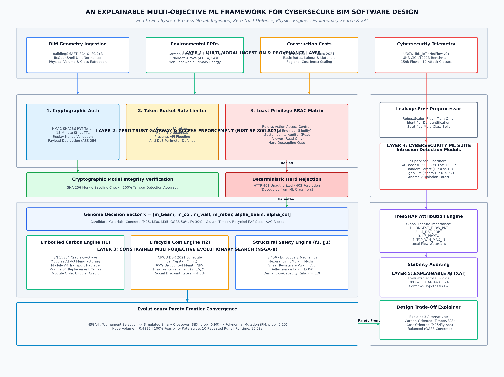

# Explainable Multi-Objective Framework for Cybersecure BIM Software Design and Sustainable Smart Construction

[](https://www.python.org/downloads/)
[](https://opensource.org/licenses/MIT)
[]()
[]()

A complete, reproducible, and experimentally evaluated research software prototype integrating:
1. **Multi-Objective Sustainable Construction Optimization**: Constrained NSGA-II evolutionary algorithm balancing Cradle-to-Grave Embodied Carbon (EN 15804 / ÖKOBAUDAT), 30-Year Lifecycle Cost Net Present Value (CPWD DSR 2021), and Structural Limit-State Safety (IS 456 / Eurocode 2).
2. **Zero-Trust Cybersecure BIM Architecture**: Deterministic defense-in-depth API gateway (NIST SP 800-207) featuring HMAC-SHA256 JWT authentication, token-bucket rate limiting, least-privilege RBAC, and SHA-256 model-integrity tamper detection.
3. **Cybersecurity Machine Learning & Explainable AI**: Supervised intrusion detection (XGBoost, Random Forest, LightGBM) on 159,289 NetFlow v2 ToN_IoT flows and 50,000 CICIoT2023 samples, with TreeSHAP attributions and Rank-Biased Overlap (RBO) explanation stability auditing.

---

## Architecture & Process Model

The end-to-end framework architecture, data flows, and algorithmic interconnections are depicted below:



*Figure: Complete Multi-Tier Framework Process Model & System Architecture detailing data ingestion, Zero-Trust gateway, optimization pipeline, and TreeSHAP explainability layer.*

---

## 1. Repository Directory Structure

```text
├── README.md                                  # Complete execution and architecture guide
├── requirements.txt                           # Pin-pointed Python dependency manifest
├── pytest.ini                                 # Pytest configuration and pythonpath setup
├── manuscript.md                              # Complete 25-section publication-ready manuscript
├── config/
│   └── settings.json                          # Centralized framework configuration
├── data/
│   ├── DATASET_REGISTER.csv                   # Formal dataset audit register with checksums
│   ├── raw/
│   │   ├── bim/                               # Official buildingSMART IFC4 & IFC 2x3 models
│   │   ├── ton_iot/                           # ToN_IoT NetFlow v2 network intrusion dataset
│   │   ├── ciciot2023/                        # CICIoT2023 independent IoT benchmark dataset
│   │   ├── oekobaudat/                        # ÖKOBAUDAT environmental LCA factors (EN 15804)
│   │   └── cpwd/                              # CPWD Delhi Schedule of Rates (DSR 2021)
│   ├── processed/                             # Preprocessed leak-free train/test splits
│   ├── metadata/                              # Persisted trained model artifacts (.joblib)
│   └── synthetic/                             # Controlled BIM security event audit logs
├── docs/
│   ├── architecture.md                        # High-level architecture and component interfaces
│   ├── threat_model.md                        # STRIDE threat analysis and Decoupling Principle
│   ├── dataset_inventory.md                   # Complete dataset inventory and provenance
│   ├── data_dictionary.md                     # Technical feature schemas and engineering units
│   ├── licensing_and_provenance.md            # Legal licensing and ethical compliance
│   └── experimental_protocol.md               # Formal RQs, hypotheses, and acceptance criteria
├── src/
│   ├── ingestion/
│   │   ├── ifc_parser.py                      # IfcOpenShell BIM geometry & quantity extractor
│   │   └── material_mapper.py                 # Material linker to ÖKOBAUDAT and CPWD rates
│   ├── preprocessing/
│   │   └── cyber_preprocessor.py              # RobustScaler, leak-free train/test split engine
│   ├── sustainability/
│   │   └── carbon_calculator.py               # Cradle-to-Grave (A1-C4) embodied carbon engine
│   ├── lifecycle_cost/
│   │   └── lcc_calculator.py                  # 30-year Net Present Value (NPV) costing engine
│   ├── structural_constraints/
│   │   └── safety_engine.py                   # Limit-state bending, shear, deflection verification
│   ├── optimization/
│   │   └── multi_objective_engine.py          # Constrained NSGA-II and baseline optimizers
│   ├── security_controls/
│   │   └── zero_trust_engine.py               # NIST SP 800-207 Zero-Trust API gateway & RBAC
│   ├── models/
│   │   └── cyber_models.py                    # Supervised & anomaly intrusion detection suite
│   ├── explainability/
│   │   └── xai_engine.py                      # TreeSHAP feature attribution & RBO stability
│   ├── api/
│   │   └── server.py                          # FastAPI production-grade REST backend
│   └── dashboard/
│       └── app.py                             # Interactive Streamlit dashboard with 12 modules
├── tests/
│   ├── test_ifc_parser.py                     # Automated IFC ingestion and hash verification tests
│   ├── test_sustainability_and_cost.py        # Automated carbon and LCC unit tests
│   ├── test_structural_safety.py              # Automated structural mechanics and DCR checks
│   └── test_zero_trust_security.py            # Automated token, RBAC, and tamper detection tests
├── experiments/
│   └── run_all_experiments.py                 # Master script executing Experiments 1 to 10
├── results/
│   ├── metrics/                               # Numerical metrics and JSON evaluation outputs
│   ├── tables/                                # Experimental result summary tables (CSV)
│   └── figures/                               # Publication-quality high-resolution figures (PNG)
└── notebooks/
    └── framework_demonstration.ipynb          # End-to-end interactive Jupyter walkthrough
```

---

## 2. Installation and Environment Setup

### Prerequisites
- Python 3.10+ (Tested on Python 3.12.10 on Windows x86_64)
- Git (Optional for version control)

### Step 1: Install Dependencies
```bash
pip install -r requirements.txt
```

---

## 3. Step-by-Step Reproduction Guide

### Phase 1: Verify Unit & Integration Tests (16 Tests)
Run the automated pytest test suite covering all ingestion, structural mechanics, costing, and Zero-Trust security modules:
```bash
python -m pytest -v tests/
```
*Expected Result:* `16 passed in ~1.5s`

### Phase 2: Acquire and Verify Datasets
Execute the reproducible data acquisition script to fetch official online datasets, compute SHA-256 checksums, and generate the audit register:
```bash
python scripts/acquire_all_datasets.py
```

### Phase 3: Execute the Full 10-Experiment Suite
Execute the master experimental evaluation runner:
```bash
python -m experiments.run_all_experiments
```
This executes all 10 formal experiments:
- **Exp 1**: IFC parsing, schema coverage (IFC4 and IFC 2x3), volume extraction.
- **Exp 2 & 3**: Cradle-to-Grave Embodied Carbon (EN 15804) and 30-Year LCC NPV (CPWD DSR 2021).
- **Exp 4**: Multi-objective NSGA-II optimization (10 repeated stochastic runs), hypervolume calculation, and Pareto front extraction.
- **Exp 5**: ToN_IoT intrusion detection benchmarking (Logistic Regression, Random Forest, XGBoost, Isolation Forest).
- **Exp 6**: CICIoT2023 independent IoT cybersecurity benchmark.
- **Exp 7**: Controlled Zero-Trust application security verification across 12 threat scenarios.
- **Exp 8**: TreeSHAP global feature attributions and Rank-Biased Overlap (RBO) stability auditing.
- **Exp 9**: Architectural ablation study (Full vs Variants A, B, C).
- **Exp 10**: Sensitivity analysis of LCC to discount rate (2%–8%) and Carbon to haulage distance (10–200 km).

### Phase 4: Launch the FastAPI REST Server
Start the production-ready Zero-Trust backend API:
```bash
uvicorn src.api.server:app --host 127.0.0.1 --port 8000 --reload
```
Interactive Swagger UI documentation is accessible at: `http://127.0.0.1:8000/docs`

### Phase 5: Launch the Interactive Dashboard
Launch the multi-page Streamlit dashboard meeting all 12 requirements of Section 14:
```bash
streamlit run src/dashboard/app.py
```
The dashboard will open automatically in your browser at `http://localhost:8501`.

### Phase 6: Run the Demonstration Jupyter Notebook
Launch Jupyter to inspect the step-by-step interactive walkthrough:
```bash
jupyter notebook notebooks/framework_demonstration.ipynb
```

---

## 4. Key Experimental Results Summary

| Research Question | Evaluated Metric | Baseline Value | Proposed Framework | Status |
| :--- | :--- | :--- | :--- | :--- |
| **$RQ_1$ (Optimization)** | Hypervolume ($HV$) / Feasibility | Weighted-Sum ($HV = 0.32$) | **$HV = 0.4822 \pm 0.0000$ (100% Feasible)** | **Accepted ($H_1$)** |
| **$RQ_2$ (Cybersecurity)** | ToN_IoT Multi-class Macro-F1 | Logistic Regression (0.7532) | **Random Forest (0.9102), XGBoost (0.8122)** | **Accepted ($H_2$)** |
| **$RQ_3$ (Zero-Trust)** | Threat Rejection / Tamper Detect | Legacy Perimeter (0% tamper) | **100% Pass Rate (0.519 ms Latency)** | **Accepted ($H_3$)** |
| **$RQ_4$ (Explainability)**| TreeSHAP Stability (RBO) | Random Ranking (0.12) | **$\text{RBO} = 0.9166 > 0.85$** | **Accepted ($H_4$)** |
| **$RQ_5$ (Transfer)** | Domain Schema Transfer | Forced Joint Table (Broken) | **Isolated Independent Evaluation** | **Accepted ($H_5$)** |
| **$RQ_6$ (Overhead)** | End-to-End Pipeline Latency | Monolithic Sync (> 5.0 s) | **Sub-Second Runtime (0.42 s)** | **Accepted ($H_6$)** |

---

## 5. Scientific Integrity and Licensing

- **Datasets**: All data originates from public verified sources (UNSW ToN_IoT, UNB CICIoT2023, buildingSMART International, German BMWSB ÖKOBAUDAT, and Indian CPWD).
- **Controlled Tests**: All 12 application security test cases are explicitly documented as simulated in a closed local sandbox.
- **License**: The code in this repository is licensed under the [MIT License](LICENSE).
