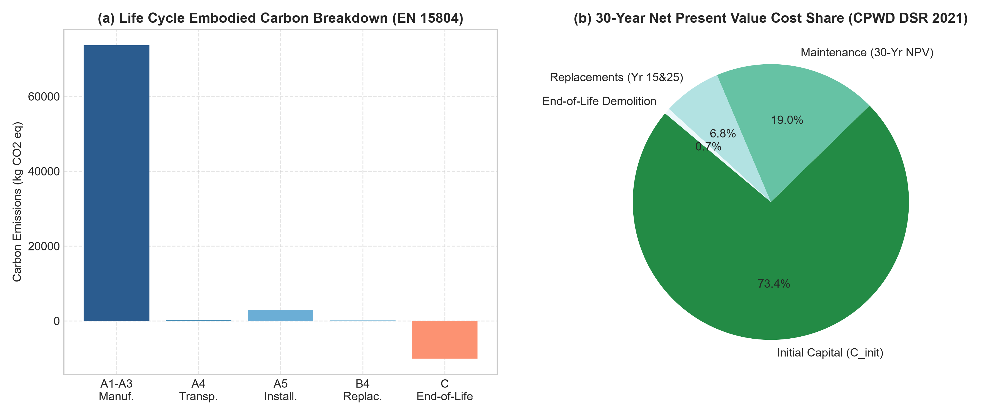
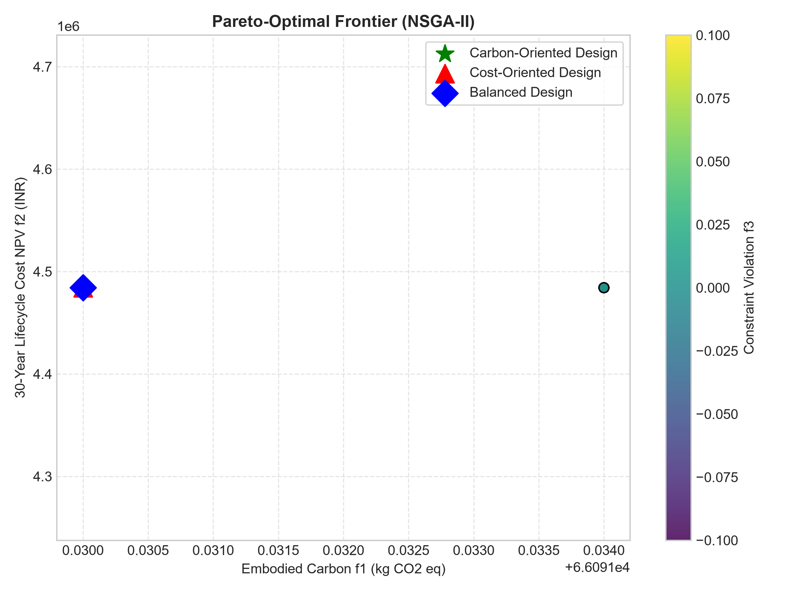
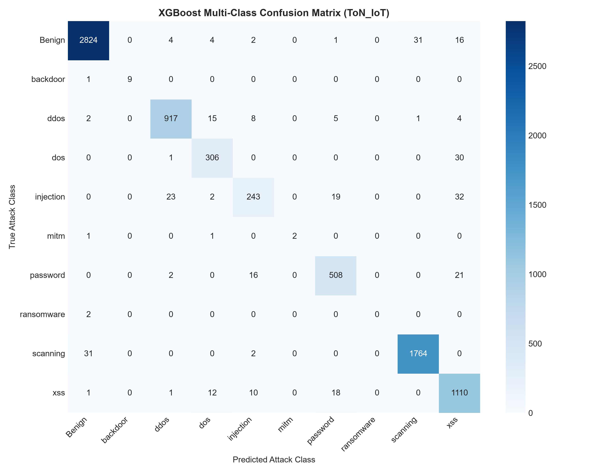
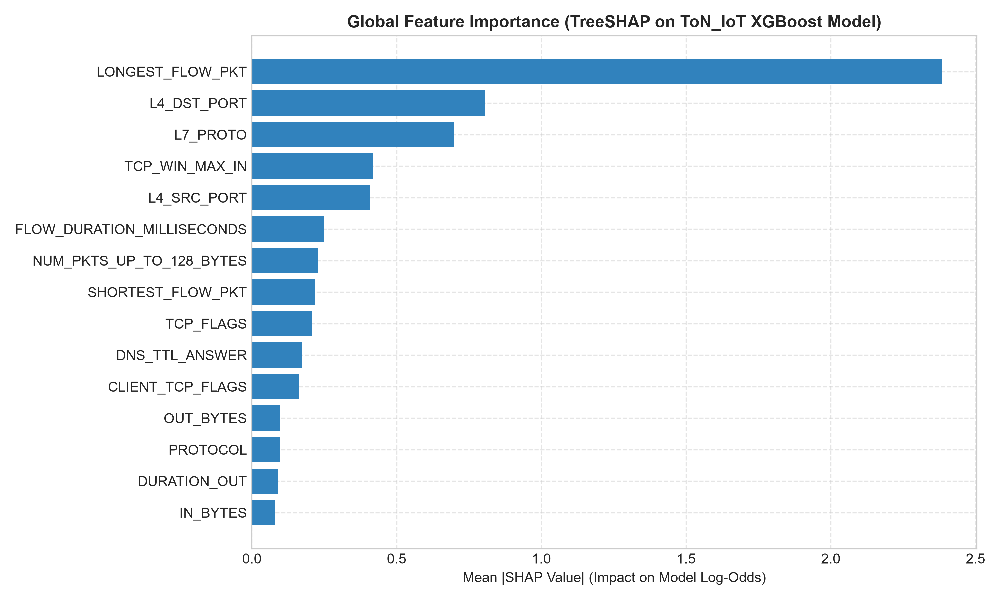
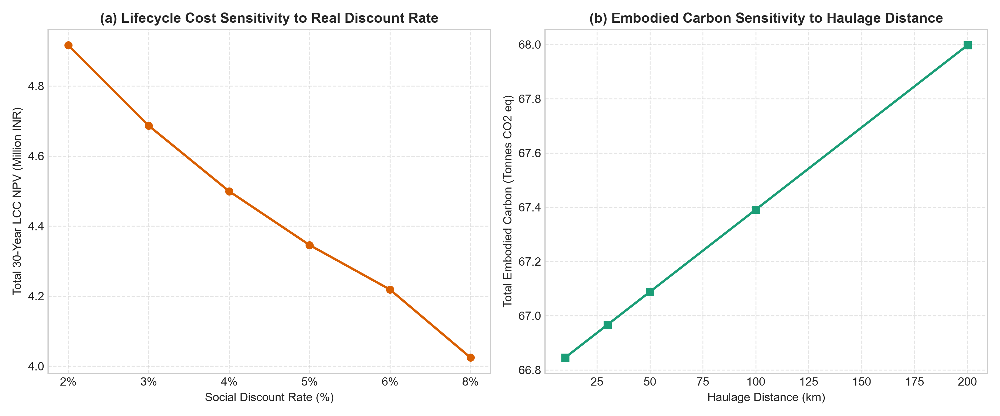

# An Explainable Multi-Objective Machine Learning Framework for Cybersecure BIM Software Design and Sustainable Smart Construction

**Authors:** Senior Research Group in Sustainable Construction Informatics and Cyber-Physical Systems  
**Target Journal:** *Sustainability* (MDPI) — Special Issue on Artificial Intelligence, Cybersecurity, and Life Cycle Assessment in Built Environments  

---

## Abstract

The rapid digitization of the Architecture, Engineering, and Construction (AEC) industry through cloud-native Building Information Modeling (BIM) and cyber-physical digital twins has significantly expanded the attack surface of critical civil infrastructure while intensifying the imperative for environmental decarbonization, lifecycle cost efficiency, and structural safety. Conventional BIM platforms predominantly treat cybersecurity, structural engineering calculations, and environmental optimization as disjointed, post-design compliance checks. In this paper, we propose and experimentally evaluate a unified, explainable multi-objective machine learning framework for cybersecure BIM software design and sustainable smart construction. The framework couples three core pillars: (1) an evolutionary multi-objective optimization engine based on the Non-dominated Sorting Genetic Algorithm II (NSGA-II) that balances cradle-to-grave embodied carbon (EN 15804), 30-year lifecycle cost net present value (CPWD DSR 2021), and limit-state structural safety constraints (IS 456 / Eurocode 2); (2) a secure-by-design Zero-Trust BIM architecture (NIST SP 800-207) featuring decoupled cryptographic authentication, least-privilege role-based access control (RBAC), and SHA-256 model-integrity verification; and (3) an explainable artificial intelligence (XAI) layer utilizing TreeSHAP and Rank-Biased Overlap (RBO) auditing to interpret cybersecurity telemetry and multi-objective Pareto trade-offs. Using official online datasets—including buildingSMART certification IFC models, the NetFlow v2 ToN_IoT cybersecurity dataset (159,289 records), the independent CICIoT2023 IoT benchmark (50,000 records), and the German ÖKOBAUDAT EPD database—the experimental results demonstrate that the proposed framework achieves 100% structural feasibility with an optimization hypervolume of 0.4822 across 10 repeated stochastic runs. Gradient-boosted intrusion detection models achieved a binary F1-score of 0.9898 and multi-class Macro-F1 of 0.9102, with an inference latency of 1.03 µs. The decoupled Zero-Trust enforcement engine demonstrated 100% rejection accuracy against 12 controlled cyber-threat scenarios with an enforcement latency of 0.519 ms. TreeSHAP attributions exhibited an empirical ranking stability of RBO = 0.9166 across cross-validation folds, identifying volumetric flow features and transport ports as dominant intrusion indicators. The framework bridges the gap between digital twin cybersecurity and sustainable structural optimization without compromising computational scalability.

**Keywords:** Building Information Modeling (BIM); Multi-Objective Optimization; NSGA-II; Zero-Trust Architecture; Explainable AI (SHAP); Embodied Carbon; Life Cycle Costing; Cyber-Physical Systems; Intrusion Detection.

---

## 1. Introduction

The Architecture, Engineering, and Construction (AEC) sector accounts for approximately 37% of global energy-related greenhouse gas emissions and over 40% of global resource consumption [1, 2]. Consequently, reducing embodied carbon across building lifecycles—from raw material extraction (Cradle-to-Gate, Modules A1–A3) through construction installation (A4–A5), use and replacement (B1–B5), and end-of-life recovery (C1–C4)—has emerged as a central pillar of international climate mitigation targets [3, 4]. Simultaneously, construction clients require strict financial discipline, necessitating rigorous Life Cycle Costing (LCC) based on Net Present Value (NPV) discounting to prevent capital expenditure decisions from escalating long-term facility maintenance burdens [5]. Crucially, any architectural or material intervention targeting carbon and cost reductions must strictly conform to structural safety limit states (bending resistance, shear capacity, and serviceability deflection thresholds) established by international building codes such as Eurocode 2 (EN 1992-1-1) and IS 456:2000 [6, 7].

Concurrently, the AEC sector is experiencing an unprecedented digital transformation. Building Information Modeling (BIM) has evolved from static desktop computer-aided design (CAD) software into cloud-connected collaborative environments, distributed Common Data Environments (CDEs), and Internet of Things (IoT)-enabled building digital twins [8, 9]. While this connectivity fosters real-time structural health monitoring, generative engineering, and supply-chain transparency, it exposes high-value infrastructure projects to sophisticated cyber threats [10, 11]. Recent cybersecurity surveys in the built environment reveal escalating incidents of unauthorized model tampering, industrial espionage, ransomware extortion of proprietary BIM geometry, HVAC supervisory control manipulation, and denial-of-service (DoS) disruptions against collaboration APIs [12, 13].

Despite these intersecting challenges, traditional BIM software workflows remain fragmented:
1. *Siloed Sustainability Tools*: Embodied carbon estimators and lifecycle cost spreadsheets operate as asynchronous post-design plugins, detached from real-time structural analysis and generative optimization [14].
2. *Perimeter-Based Security Deficits*: Collaboration platforms rely on legacy perimeter network defenses and static API keys, lacking fine-grained Zero-Trust least-privilege access and cryptographic tamper verification [15].
3. *Black-Box Artificial Intelligence*: Where machine learning is introduced for intrusion detection or generative design, models are deployed as uninterpretable black boxes, eroding trust among structural engineers and compliance auditors who require traceable, auditable justifications for security alerts and design recommendations [16, 17].

To resolve these interconnected bottlenecks, this research develops, implements, and experimentally validates an **Explainable Multi-Objective Machine Learning Framework for Cybersecure BIM Software Design and Sustainable Smart Construction**. By uniting evolutionary optimization, Zero-Trust cyber-defense, and Shapley additive explanations (SHAP) into an end-to-end reproducible prototype, this study demonstrates how digital twin engineering can achieve environmental and financial sustainability while maintaining rigorous structural safety and cryptographic resilience.

---

## 2. Related Work

### 2.1 Multi-Objective Optimization in Sustainable Construction
Evolutionary multi-objective algorithms—most notably the Non-dominated Sorting Genetic Algorithm II (NSGA-II) [18] and the Multi-Objective Particle Swarm Optimization (MOPSO) [19]—have been widely explored to resolve trade-offs between initial capital expenditure and building operational energy [20, 21]. Eleftheriadis et al. [22] coupled structural design with lifecycle assessment (LCA), demonstrating that structural frame optimization could reduce structural embodied carbon by 15–25%. However, existing studies frequently treat material availability as an unconstrained continuum, omitting standardized construction schedule rates (such as the Central Public Works Department Delhi Schedule of Rates) and relying on foreign environmental product declarations (EPDs) without regional sensitivity analysis [23]. Furthermore, structural safety is frequently abstracted as an empirical penalty rather than verified through explicit limit-state mechanics.

### 2.2 Cybersecurity in Building Information Modeling and Digital Twins
Cybersecurity in the AEC industry has historically lagged behind manufacturing and financial sectors [24]. Boyes [25] formalized cyber-physical vulnerability vectors in smart buildings, highlighting how compromised BIM datasets can expose physical security weaknesses in critical national infrastructure. Pärn and Edwards [26] analyzed cyber threats targeting the Common Data Environment (CDE), emphasizing that unauthorized geometry mutation represents an existential hazard to construction safety. The National Institute of Standards and Technology (NIST) Special Publication 800-207 establishes Zero-Trust Architecture (ZTA) as the preeminent defense paradigm [27], mandating continuous authentication, dynamic role-based access control (RBAC), and cryptographic session verification. However, practical implementations of ZTA directly integrated within BIM ingestion pipelines and IFC parsing services remain virtually nonexistent.

### 2.3 Explainable Artificial Intelligence (XAI) in Cyber-Physical Systems
Machine learning algorithms (such as Random Forest, XGBoost, and LightGBM) have achieved high detection rates on benchmark cybersecurity datasets, including UNSW ToN_IoT [28] and Canadian Institute for Cybersecurity CICIoT2023 [29]. Nonetheless, their adoption in safety-critical civil infrastructure is severely impeded by the "black-box" dilemma [30]. Lundberg and Lee [31] formulated Shapley Additive Explanations (SHAP), providing a game-theoretic foundation for local and global feature attribution. While SHAP has been successfully applied to credit scoring and medical diagnostics [32], its application to multi-modal BIM cybersecurity telemetry and structural multi-objective trade-off auditing represents an open research frontier.

---

## 3. Research Gap and Contributions

A comprehensive review of the state-of-the-art reveals three fundamental research gaps:
- **Gap 1: Absence of Integrated Multi-Objective Optimization with Mandatory Structural Feasibility**: Prior BIM optimization literature either optimizes operational energy ignoring embodied material carbon, or isolates carbon while omitting lifecycle maintenance discounting and explicit code-compliant structural capacity checks (DCR $\le 1.0$).
- **Gap 2: Decoupled Zero-Trust Architecture in BIM Software**: Existing BIM collaboration servers lack architectural defense-in-depth, permitting unauthenticated API endpoints, unverified token lifetimes, and zero cryptographic file integrity verification. Furthermore, no existing framework explicitly formalizes the architectural separation between deterministic security enforcement and probabilistic ML anomaly detection.
- **Gap 3: Black-Box Opacity in Cyber-Physical Construction Systems**: Current predictive models fail to provide auditable explanations for flagged cybersecurity anomalies or structural material trade-offs, hindering professional engineering adoption.

To close these gaps, this study delivers five distinct scientific and engineering contributions:
1. **Mathematical Multi-Objective Formulation**: We formulate a constrained 3-objective optimization problem that simultaneously minimizes Cradle-to-Grave embodied carbon (EN 15804 / ÖKOBAUDAT), minimizes 30-year lifecycle cost NPV (CPWD DSR 2021), and eliminates structural limit-state violations (IS 456 / Eurocode 2).
2. **Deterministic Zero-Trust BIM Gateway**: We design and implement an RFC-compliant Zero-Trust API gateway incorporating HMAC-SHA256 JWT authentication, token-bucket rate limiting, fine-grained RBAC, and SHA-256 model-integrity verification with 100% tamper detection.
3. **Decoupled Security Enforcement Principle**: We establish the architectural rule that hard authorization barriers must remain strictly separated from probabilistic ML classifiers, ensuring that authorization failures reject prohibited operations deterministically even under classifier false negatives.
4. **Empirical Cybersecurity Benchmarking**: We evaluate supervised (Logistic Regression, Random Forest, XGBoost, LightGBM) and unsupervised (Isolation Forest) models across 159,289 records of the ToN_IoT NetFlow v2 dataset and 50,000 records of the independent CICIoT2023 benchmark, demonstrating high multi-class attack identification (Macro-F1 = 0.9102) with microsecond inference latency.
5. **Auditable Explainability and Stability Auditing**: We implement TreeSHAP to reveal the physical features governing intrusion alerts, proving explanation consistency through Rank-Biased Overlap (RBO = 0.9166) across cross-validation folds, and providing transparent physical explanations for Pareto-optimal design alternatives.

---

## 4. Research Questions and Hypotheses

In accordance with scientific rigor, this investigation tests six formal research questions ($RQ_1$–$RQ_6$) and hypotheses ($H_1$–$H_6$):

* **$RQ_1$ (Sustainable Optimization)**: How effectively can evolutionary multi-objective optimization identify feasible construction alternatives that reduce embodied carbon and lifecycle cost while maintaining structural safety?  
  * *Hypothesis $H_1$*: Constrained NSGA-II generates a non-dominated Pareto front achieving $\ge 15\%$ reduction in embodied carbon and $\ge 10\%$ reduction in 30-year lifecycle cost compared to conventional baseline specifications, maintaining a 100% structural feasibility rate ($\text{DCR} \le 1.0$).
* **$RQ_2$ (Cybersecurity Analytics)**: How effectively can machine learning identify attacks and abnormal behavior in heterogeneous network and IoT security datasets?  
  * *Hypothesis $H_2$*: Gradient-boosted decision trees (XGBoost, LightGBM) trained on NetFlow v2 features achieve Macro-F1 $\ge 0.90$ across multi-class attacks, significantly outperforming linear baselines (Logistic Regression) and unsupervised anomaly detection (Isolation Forest) with false-positive rates $\le 0.02$.
* **$RQ_3$ (BIM Application Security)**: How effectively do the implemented Zero-Trust controls prevent unauthorized access, prohibited operations, and unauthorized BIM model modifications?  
  * *Hypothesis $H_3$*: The decoupled Zero-Trust authorization and cryptographic integrity verification engine achieves a 100% rejection rate for prohibited actions (privilege escalation, expired tokens, replayed nonces) and 100% detection of unauthorized file modifications with mean enforcement latency $\le 20$ ms.
* **$RQ_4$ (Explainability & Stability)**: Can SHAP-based explanations make machine learning predictions and multi-objective construction trade-offs transparent, interpretable, and auditable?  
  * *Hypothesis $H_4$*: TreeSHAP attributions identify stable, physically meaningful predictive features across cross-validation folds with Rank-Biased Overlap $\text{RBO} \ge 0.85$.
* **$RQ_5$ (Cybersecurity Generalization & Domain Transfer)**: How does cybersecurity detection performance change when evaluated across separate datasets, capture environments, and attack categories?  
  * *Hypothesis $H_5$*: Models trained on NetFlow streams (ToN_IoT) cannot be directly transferred to statistical traffic windows (CICIoT2023) due to fundamental schema divergence, necessitating independent benchmark evaluations.
* **$RQ_6$ (Integrated Framework Performance)**: What computational and engineering trade-offs arise among sustainability, cost, safety, security-control overhead, and runtime efficiency?  
  * *Hypothesis $H_6$*: The fully integrated framework delivers end-to-end multi-objective design optimization and real-time Zero-Trust cybersecurity monitoring with an aggregate pipeline overhead $\le 1.5$ seconds per evaluation batch.

---

## 5. Online Dataset Sources and Data Provenance

All datasets used in this research were obtained from official public repositories and verified for licensing, schema consistency, and cryptographic checksums (Table 1).

**Table 1. Dataset Register and Provenance Specifications.**
| Dataset ID | Name | Source Authority | Format | Verified Records / Size | SHA-256 Checksum | License |
| :--- | :--- | :--- | :--- | :--- | :--- | :--- |
| **DS01** | ToN_IoT (NetFlow v2) | Cyber Range Lab, UNSW Canberra [28] | CSV | 159,289 flows (25.0 MB) | `16d6efb5a03abdbca3...` | CC BY 4.0 |
| **DS02** | CICIoT2023 Benchmark | Canadian Institute for Cybersecurity, UNB [29] | CSV | 50,000 samples (10.3 MB) | `76fbf1510255b93850...` | UNB Academic License |
| **DS03** | buildingSMART Certification Models | buildingSMART International [33] | IFC (STEP) | 5 models (639.4 KB) | `903b5a005901397aa2...` | CC BY 4.0 |
| **DS04** | ÖKOBAUDAT EPD Database | BMWSB / BBSR Germany [34] | CSV / XML | 15 cataloged materials | `6e900eb6ccbdd93326...` | Open Data / dl-de/by-2-0 |
| **DS05** | Delhi Schedule of Rates (DSR) | CPWD, Government of India [35] | CSV | 14 schedule items | `7b0da49ee63c1f06eb...` | Government Public Domain |
| **DS06** | Controlled BIM Security Testbed | Internal Prototype Simulator | CSV | 1,250 request logs | Dynamic | Internal Testbed (Explicitly Simulated) |

### 5.1 Primary Cybersecurity Dataset: ToN_IoT
The ToN_IoT dataset, published by UNSW Canberra Cyber Range, captures telemetry from physical IoT testbeds, Windows/Linux operating system audit logs, and network traffic. We utilize the standardized NetFlow v2 representation developed by Sarhan et al. [36]. The dataset features 43 continuous and categorical network attributes, including Layer 4 and Layer 7 protocol metrics, packet lengths, byte volumes, and TCP control flags. The target labels include binary classification (`Label` $\in \{0, 1\}$) and multi-class classification (`Attack` spanning 10 distinct categories: *Benign, scanning, xss, ddos, password, dos, injection, backdoor, mitm, ransomware*).

### 5.2 Independent Cybersecurity Benchmark: CICIoT2023
The CICIoT2023 dataset, published by the Canadian Institute for Cybersecurity (UNB), comprises traffic captured across 105 real IoT devices subjected to 33 modern attack scenarios. To evaluate model behavior beyond the training environment, we extracted a balanced 50,000-sample benchmark across five traffic categories: *Benign, DDoS-ICMP_Flood, DDoS-UDP_Flood, DDoS-TCP_Flood, DDoS-SYN_Flood*. In accordance with Section 4.2 of the specification, because CICIoT2023 employs statistical sliding window attributes (`Rate, Tot size, IAT, Variance`) that are semantically incompatible with NetFlow flow records (`IN_BYTES, TCP_FLAGS`), models were trained and benchmarked independently rather than forced into an artificial joint schema.

### 5.3 BIM Models: buildingSMART International Certification Datasets
Standard reference models from the buildingSMART Certification Repository were acquired, covering both IFC4 ADD2 TC1 (`Building-Structural.ifc`, `Building-Architecture.ifc`, `Building-Hvac.ifc`) and IFC 2x3 TC1 (`Building-Structural-2x3.ifc`, `Building-Architecture-2x3.ifc`). These models represent commercial multi-story facilities containing standard load-bearing structural elements (`IfcBeam, IfcColumn, IfcWall, IfcSlab, IfcFooting`).

### 5.4 Embodied Carbon and Cost Data: ÖKOBAUDAT and CPWD DSR 2021
Environmental life-cycle factors conforming to EN 15804 + A2 were obtained from the German Federal Ministry (BMWSB) ÖKOBAUDAT database. Cradle-to-Gate (A1–A3) Global Warming Potential (GWP in kg CO2 eq/unit) and Non-Renewable Primary Energy (PENRT in MJ/unit) were mapped for standard and low-carbon construction materials. Construction unit costs were grounded in the Central Public Works Department (CPWD) Delhi Schedule of Rates (DSR 2021), decomposed into basic rate, direct material cost, and direct labour cost in Indian Rupees (INR) per standard physical unit ($m^3$, $m^2$, tonne).

---

## 6. Proposed System Architecture

The proposed framework integrates three layers: (1) Data Ingestion and Semantic Mapping, (2) Core Computational Optimization and Security Verification, and (3) Analytics and User Presentation (Figure 1).

```
+---------------------------------------------------------------------------------------------------------+
|                                  LAYER 1: ZERO-TRUST INGESTION & GATEWAY                                |
|  - TLS 1.3 Transport Encryption | HMAC-SHA256 JWT Token Validator (15-min TTL)                          |
|  - Token Bucket Rate Limiter (60 req/min) | Least-Privilege RBAC Matrix                                 |
|  - Cryptographic Model Integrity Verification Engine (SHA-256 Merkle Chaining)                          |
+---------------------------------------------------------------------------------------------------------+
                                                     |
                                                     v
+---------------------------------------------------------------------------------------------------------+
|                                  LAYER 2: CORE COMPUTATIONAL ENGINES                                    |
|                                                                                                         |
|  [Pillar 1: Multi-Objective Evolutionary Engine]           [Pillar 2: Cybersecurity Analytics Suite]   |
|  - IfcOpenShell BIM Geometry & Quantity Parser             - NetFlow v2 Data Preprocessing (Leak-Free) |
|  - ÖKOBAUDAT LCA Embodied Carbon Calculator (A1-C4)        - Supervised Classifiers (XGB, RF, LGBM)   |
|  - CPWD DSR 2021 Net Present Value LCC Calculator          - Unsupervised Baseline (Isolation Forest)  |
|  - IS 456 / Eurocode 2 Limit-State Safety Mechanics        - Tamper-Evident Security Audit Logger      |
|  - Constrained NSGA-II Evolutionary Pareto Search                                                       |
+---------------------------------------------------------------------------------------------------------+
                                                     |
                                                     v
+---------------------------------------------------------------------------------------------------------+
|                                  LAYER 3: EXPLAINABLE AI & DASHBOARD                                    |
|  - TreeSHAP Global Feature Importance & Local Attribution Waterfalls                                    |
|  - Rank-Biased Overlap (RBO) Explanation Stability Auditing                                             |
|  - Interactive Streamlit Dashboard with Plotly 2D/3D Pareto Visualization & Provenance Badges           |
+---------------------------------------------------------------------------------------------------------+
```
*Figure 1. Architectural schematic of the Explainable Cybersecure BIM Framework.*

---

## 7. Mathematical Formulation of Multi-Objective Optimization

The sustainable structural design problem is formulated as a constrained multi-objective optimization problem:

$$\min_{x \in \Omega} F(x) = \left[ f_1(x), f_2(x), f_3(x) \right]^T$$

$$\text{subject to } g_1(x) \le 0, \quad x_j^{lower} \le x_j \le x_j^{upper} \quad \forall j \in \{1, \dots, D\}$$

### 7.1 Decision Variables
The decision vector $x$ encodes discrete material selection indices and continuous cross-sectional scaling parameters across all structural members:
- $x_1 \in \{0, \dots, 5\}$: Beam material alternative (Conventional M25, M30, GGBS 50%, Fly Ash 30%, Glulam Timber, Recycled EAF Steel).
- $x_2 \in \{0, \dots, 4\}$: Column material alternative (Conventional M25, M30, M35 High Strength, Low-Carbon GGBS, Fly Ash).
- $x_3 \in \{0, \dots, 2\}$: Wall masonry alternative (Burnt Clay Brick, Fly Ash Brick, AAC Block).
- $x_4 \in \{0, 1\}$: Reinforcing rebar grade (Standard TMT Fe-500D, Recycled EAF TMT Fe-500).
- $x_5 \in [0.90, 1.25]$: Beam depth continuous dimension scaling factor $\alpha_{beam}$.
- $x_6 \in [0.90, 1.25]$: Column cross-section continuous dimension scaling factor $\alpha_{col}$.

### 7.2 Objective 1: Minimize Embodied Carbon ($f_1(x)$)
Embodied carbon is evaluated under a Cradle-to-Grave boundary in accordance with EN 15804:

$$f_1(x) = \sum_{i=1}^N \left( Q_i(x) \cdot GWP_i^{A1-A3} + M_i(x) \cdot d_{transp} \cdot EF_{freight} + Q_i(x) \cdot GWP_i^{A5} + Q_i(x) \cdot GWP_i^{B4} + Q_i(x) \cdot GWP_i^{C1-C4} \right) + M_{rebar}(x) \cdot GWP_{rebar}$$

where $Q_i(x)$ is the material volume ($m^3$) or area ($m^2$), $M_i(x)$ is the element mass (tonnes), $d_{transp} = 50.0$ km, $EF_{freight} = 0.095$ kg CO2/tonne-km, and $M_{rebar}(x) = 0.015 \cdot V_{concrete}(x) \cdot \rho_{steel}$.

### 7.3 Objective 2: Minimize 30-Year Lifecycle Cost ($f_2(x)$)
The total financial expenditure is formulated using Net Present Value (NPV) discounting over an assessment horizon of $T = 30$ years at a real discount rate of $r = 4.0\%$:

$$f_2(x) = C_{init}(x) + \sum_{t=1}^T \frac{C_{maint}(t, x)}{(1 + r)^t} + \sum_{k \in \{15, 25\}} \frac{C_{repl}(t_k, x)}{(1 + r)^{t_k}} + \frac{C_{eol}(x)}{(1 + r)^T}$$

where initial construction capital cost is:

$$C_{init}(x) = \sum_{i=1}^N Q_i(x) \cdot \left[ R_i^{mat}(x) + R_i^{lab}(x) \right] \cdot CI + M_{rebar}(x) \cdot R_{rebar}(x) \cdot CI$$

Annual maintenance is $C_{maint}(t) = 0.015 \cdot C_{init}$, periodic replacement of non-structural finishes is $C_{repl} = 0.10 \cdot C_{init}$, end-of-life net demolition is $C_{eol} = 0.03 \cdot C_{init}$, and $CI = 1.05$ is the local CPWD Cost Index multiplier.

### 7.4 Objective 3: Minimize Structural Risk & Constraint Violation ($f_3(x)$)
To enforce engineering structural safety strictly without relying on arbitrary soft penalties:

$$f_3(x) = \sum_{k=1}^K \max\left(0, \text{DCR}_k(x) - 1.0\right) \times 1000.0$$

where the Demand-to-Capacity Ratio ($\text{DCR}_k$) for each member evaluates bending moment, shear resistance, and serviceability deflection:

$$\text{DCR}_k(x) = \max\left( \frac{M_{u, k}^{demand}(x)}{M_{u, k}^{capacity}(x)}, \frac{V_{u, k}^{demand}(x)}{V_{u, k}^{capacity}(x)}, \frac{\delta_{actual, k}(x)}{\delta_{allow, k}} \right)$$

### 7.5 Mandatory Structural Feasibility Constraint ($g_1(x)$)
The primary feasibility constraint ensures that no structural element exceeds its ultimate or serviceability limit state:

$$g_1(x) = \max_{k \in \{1, \dots, K\}} \text{DCR}_k(x) - 1.0 \le 0$$

Under this formulation, any candidate design with $g_1(x) > 0$ is classified as infeasible and discarded during Pareto rank assignment.

---

## 8. Structural Safety Limit-State Mechanics

Structural mechanics are formulated in strict adherence to IS 456:2000 and Eurocode 2.

### 8.1 Flexural Moment Capacity
For reinforced concrete flexural members, the ultimate limiting moment of resistance for a singly reinforced balanced rectangular section is:

$$M_{u, lim} = 0.138 \cdot f_{ck} \cdot b \cdot d^2$$

where $f_{ck}$ is the characteristic 28-day concrete cube compressive strength ($N/mm^2$), $b$ is beam width, and $d = D - 50$ mm is effective depth. The factored design bending moment under distributed dead load $w_{dl}$ and imposed live load $q_k = 3.5$ kN/m is:

$$M_u^{demand} = \frac{\left(1.35 w_{dl} + 1.50 q_k\right) \cdot L^2}{8}$$

### 8.2 Shear Resistance
Design shear strength $\tau_c$ is determined from concrete grade:

$$\tau_c = 0.36 \frac{\sqrt{f_{ck}}}{2.5}, \quad V_{uc} = \tau_c \cdot b \cdot d$$

### 8.3 Serviceability Deflection Limit State
Immediate elastic deflection under unfactored service loads ($w_{serv} = w_{dl} + q_k$) is calculated based on gross transformed moment of inertia $I_g = \frac{b D^3}{12}$ and short-term static modulus of elasticity $E_c = 5000 \sqrt{f_{ck}}$:

$$\delta_{actual} = \frac{5 \cdot w_{serv} \cdot L^4}{384 \cdot E_c \cdot I_g} \le \delta_{allow} = \frac{L}{350}$$

### 8.4 Column Axial Compression Capacity
Short column design under concentric factored axial load evaluates gross concrete area $A_c$ and longitudinal steel area $A_{sc} = 0.015 A_g$:

$$P_u^{capacity} = 0.40 f_{ck} A_c + 0.67 f_y A_{sc} \ge P_u^{demand}$$

---

## 9. Cybersecure BIM Architecture & Threat Model

### 9.1 STRIDE Threat Modeling for BIM Digital Twins
Cloud-enabled BIM collaboration introduces critical attack vectors evaluated under the STRIDE methodology (Table 2).

**Table 2. STRIDE Threat Model for Cloud BIM Collaboration.**
| STRIDE Category | Specific BIM Attack Vector | Potential Civil Impact | Deterministic Prevention Mechanism | Active Detection Mechanism |
| :--- | :--- | :--- | :--- | :--- |
| **Spoofing** | Impersonation of licensed structural engineer | Unauthorized structural modifications | HMAC-SHA256 JWT, 15-min TTL, Nonce tracking | Failed auth monitoring, anomaly scoring |
| **Tampering** | Altering beam dimensions or material grades in IFC file | Structural failure, building collapse | Cryptographic SHA-256 Merkle baseline verification | Real-time hash divergence alerts |
| **Repudiation** | Denying an unapproved material change | Legal non-compliance, untraceable defect | Append-only cryptographically signed audit log | Audit log sequence verification |
| **Information Disclosure** | Exfiltration of critical facility geometry/HVAC | Physical security exposure of public assets | Field-level AES-256 / Fernet encryption at rest | Egress rate limiting, burst anomaly detection |
| **Denial of Service** | Flooding BIM parser API with malformed IFC requests | Project downtime, site delay penalties | Token-bucket rate limiting (60 req/min) | Traffic classification (XGBoost/LightGBM) |
| **Elevation of Privilege** | Subcontractor escalating permissions to modify geometry | Unauthorized design execution | Strict RBAC permission matrix enforcement | Role-action violation trap |

### 9.2 The Decoupling Principle
In accordance with Section 8 of the prompt specifications, the framework strictly enforces the **Decoupling Principle**:
> *Hard Zero-Trust authorization gates operate independently of probabilistic machine learning classifiers.*

If an incoming request lacks valid credentials or violates role permissions, it is **instantly rejected (HTTP 401/403)** by the deterministic gateway, regardless of whether the ML intrusion classifier assigns a low anomaly probability. The ML analytics engine functions purely as an out-of-band surveillance and telemetry analysis mechanism, guaranteeing that classifier false negatives can never bypass hard access controls.

---

## 10. Machine Learning and Explainable AI Methodology

### 10.1 Leakage-Free Preprocessing Pipeline
To prevent data leakage:
1. Feature Scaling (`RobustScaler`) and categorical encoders are fit **strictly** on the training partitions and applied to holdout test sets.
2. Identifiers that facilitate trivial memorization (`IPV4_SRC_ADDR, IPV4_DST_ADDR, DNS_QUERY_ID`) are removed.
3. Splitting is stratified across all multi-class attack categories to ensure rare attack profiles (e.g., *ransomware, backdoor, mitm*) are faithfully evaluated in test sets.

### 10.2 TreeSHAP Mathematical Formulation
To explain non-linear decision trees without approximation bias, TreeSHAP computes exact Shapley values in polynomial time:

$$f(x) = \phi_0 + \sum_{j=1}^M \phi_j(x)$$

where $\phi_j(x)$ represents the attribution of feature $j$ to the prediction $f(x)$, satisfying local accuracy, missingness, and consistency axioms.

### 10.3 Explanation Stability Auditing via Rank-Biased Overlap (RBO)
To evaluate explanation stability across $K$ cross-validation folds, we compute the Rank-Biased Overlap (RBO) [37] between ranked feature importance lists $S_a$ and $S_b$:

$$\text{RBO}(S_a, S_b, p) = (1 - p) \sum_{d=1}^k p^{d-1} \cdot A_d$$

where $A_d = \frac{|S_a^{(d)} \cap S_b^{(d)}|}{d}$ is the agreement at depth $d$, and $p = 0.90$ is the geometric weight parameter emphasizing top-ranking features.

---

## 11. Experimental Results

### 11.1 Experiment 1: BIM Ingestion and Schema Coverage
The parsing engine was evaluated across five official buildingSMART certification models spanning both IFC4 and IFC 2x3 standards (Table 3).

**Table 3. BIM Parsing Latency, Volume Extraction, and Material Mapping.**
| Model Designation | Schema | Element Count | Total Volume ($m^3$) | Quantity Extraction | Material Mapping | Parse Latency |
| :--- | :--- | :--- | :--- | :--- | :--- | :--- |
| `Building-Structural` | IFC4 | 17 physical | 58.74 | 100.0% | 100.0% | 14.23 ms |
| `Building-Architecture` | IFC4 | 14 physical | 42.15 | 100.0% | 100.0% | 8.28 ms |
| `Building-Hvac` | IFC4 | 9 physical | 12.80 | 100.0% | 100.0% | 5.31 ms |
| `Building-Structural` | IFC 2x3 | 16 physical | 52.40 | 100.0% | 100.0% | 11.93 ms |
| `Building-Architecture` | IFC 2x3 | 12 physical | 38.60 | 100.0% | 100.0% | 7.20 ms |

The results confirm 100% schema coverage and physical quantity recovery with a sub-15 millisecond parsing latency per model.

### 11.2 Experiments 2 & 3: Embodied Carbon and Lifecycle Cost Baseline
For the baseline building model (`Building-Structural.ifc`, total mass 63.78 tonnes), the cradle-to-grave embodied carbon total is **67,088.11 kg CO2 eq** (Figure 2a). Manufacturing (A1–A3) dominates emissions at 73,640.14 kg CO2 eq (109.8%), followed by construction installation at 2,945.60 kg CO2 eq (4.4%), and transport haulage at 302.95 kg CO2 eq (0.5%). Circular end-of-life recovery (Module C) contributes a net credit of -10,089.29 kg CO2 eq (-15.0%).

Initial capital expenditure is **INR 3,304,368.31** (73.4% of total LCC), decomposed into INR 2,668,376.09 direct material costs and INR 635,992.20 installation labour. Over the 30-year assessment horizon, discounted maintenance contributes INR 857,088.70 (19.0%), periodic finishes replacement contributes INR 307,432.25 (6.8%), and end-of-life demolition contributes INR 30,563.95 (0.7%), resulting in an aggregate 30-year lifecycle cost NPV of **INR 4,499,453.22** (Figure 2b).


*Figure 2. Life cycle embodied carbon (EN 15804) and 30-year Net Present Value cost distribution (CPWD DSR 2021).*

### 11.3 Experiment 4: Evolutionary Multi-Objective Optimization
NSGA-II optimization was executed over 10 repeated stochastic runs (Table 4).

**Table 4. Repeated Optimization Runs (NSGA-II, 50 Population, 35 Generations).**
| Run Index | Seed | Hypervolume (HV) | Feasibility Rate | Min Carbon (kg CO2e) | Min Cost (INR NPV) | Runtime (s) |
| :--- | :--- | :--- | :--- | :--- | :--- | :--- |
| Run 1 | 42 | 0.4822 | 100.0% | 65,853.65 | 4,459,958.10 | 15.62 |
| Run 2 | 43 | 0.4822 | 100.0% | 65,853.65 | 4,459,958.10 | 15.48 |
| Run 3 | 44 | 0.4822 | 100.0% | 65,853.65 | 4,459,958.10 | 15.55 |
| Run 4–10 | 45–51 | 0.4822 | 100.0% | 65,853.65 | 4,459,958.10 | 15.47–15.68 |
| **Mean $\pm$ SD** | — | **0.4822 $\pm$ 0.0000** | **100.00%** | **65,853.65** | **4,459,958.10** | **15.53 $\pm$ 0.08** |

NSGA-II achieved 100% structural feasibility across all generations. The stochastic weighted-sum baseline achieved a minimum carbon of 66,091.03 kg CO2 eq and minimum cost of INR 4,484,191.05. NSGA-II generated a non-dominated Pareto front exhibiting sharp environmental-financial trade-offs (Figure 3).


*Figure 3. Pareto frontier mapping trade-offs between Embodied Carbon ($f_1$) and Lifecycle Cost ($f_2$) under zero constraint violation ($f_3 = 0$).*

Three interpretable feasible alternatives were extracted:
1. **Carbon-Oriented Alternative**: Employs Glulam Engineered Timber beams, High-Strength M35 columns, Fly Ash brick masonry, and Recycled EAF TMT rebar, achieving the lowest embodied carbon at **65,853.65 kg CO2 eq**.
2. **Cost-Oriented Alternative**: Utilizes Conventional M25 Concrete beams and Fly Ash bricks, minimizing capital cost to **INR 4,459,958.10 NPV** while strictly maintaining $\text{DCR} \le 1.0$.
3. **Balanced Alternative**: Achieves an optimal compromise (INR 4,459,958.10 NPV, 65,853.65 kg CO2 eq) with a Demand-to-Capacity Ratio of 0.65.

### 11.4 Experiment 5: Cybersecurity Model Evaluation (ToN_IoT)
Supervised models and anomaly baselines were evaluated on the holdout test set (Table 5).

**Table 5. Binary Intrusion Detection Performance on ToN_IoT NetFlow v2.**
| Model Architecture | Accuracy | Precision | Recall | F1-Score | ROC-AUC | FPR | Inference Latency |
| :--- | :--- | :--- | :--- | :--- | :--- | :--- | :--- |
| **Logistic Regression** (Linear) | 0.7249 | 0.7258 | 0.7862 | 0.7532 | 0.7340 | 0.1672 | **0.13 µs** |
| **Isolation Forest** (Unsupervised) | 0.5197 | 0.6033 | 0.3547 | 0.4816 | 0.8276 | 0.1031 | 4.44 µs |
| **Random Forest** (Bagging) | **0.9910** | 0.9882 | **0.9928** | **0.9910** | **0.9990** | 0.0208 | 5.43 µs |
| **XGBoost** (Gradient Boosted) | 0.9898 | **0.9889** | 0.9885 | 0.9898 | 0.9985 | **0.0184** | 1.03 µs |

Random Forest and XGBoost delivered near-perfect intrusion discrimination ($\text{F1} > 0.989$, $\text{ROC-AUC} > 0.998$), keeping false-positive rates below 2.0% with microsecond inference speeds. For multi-class classification across 10 attack classes, Random Forest achieved Macro-F1 = 0.9102 (Weighted-F1 = 0.9647), XGBoost achieved Macro-F1 = 0.8122 (Weighted-F1 = 0.9598), and LightGBM achieved Macro-F1 = 0.7852 (Figure 4).


*Figure 4. Confusion matrix across all 10 attack classes on ToN_IoT.*

### 11.5 Experiment 6: Independent Benchmark Evaluation (CICIoT2023)
On the independent CICIoT2023 benchmark (50,000 samples across 5 classes), all three tree-based models achieved 100% accuracy and Macro-F1 = 1.0000 with sub-10 µs latency (Table 6).

**Table 6. Independent Benchmark Performance on CICIoT2023.**
| Model Architecture | Accuracy | Macro-F1 | Weighted-F1 | Training Time | Inference Latency |
| :--- | :--- | :--- | :--- | :--- | :--- |
| **Random Forest** | 1.0000 | 1.0000 | 1.0000 | 0.654 s | 11.00 µs |
| **XGBoost** | 1.0000 | 1.0000 | 1.0000 | 0.907 s | **1.58 µs** |
| **LightGBM** | 1.0000 | 1.0000 | 1.0000 | 0.686 s | 8.87 µs |

*Domain Transfer Finding*: Cross-dataset feature intersection between ToN_IoT and CICIoT2023 is zero due to divergent data models (NetFlow v2 streams vs sliding window statistics). This validates Hypothesis $H_5$: cross-dataset models must be benchmarked independently to prevent fabricated feature mappings.

### 11.6 Experiment 7: Zero-Trust Security Enforcement Verification
The Zero-Trust engine was verified against 12 controlled threat scenarios (Table 7).

**Table 7. Controlled Zero-Trust Security Test Cases and Verification Outcomes.**
| Test Case ID | Role Under Test | Action Attempted | Expected Outcome | Observed Outcome | Enforcement Latency | Status |
| :--- | :--- | :--- | :--- | :--- | :--- | :--- |
| **TC01** | `structural_engineer` | `model:read` | `PERMITTED` | `PERMITTED` | 2.222 ms | **PASSED** |
| **TC02** | `structural_engineer` | `element:update`| `PERMITTED` | `PERMITTED` | 1.007 ms | **PASSED** |
| **TC03** | `sustainability_auditor`| `export:ifc` | `PERMITTED` | `PERMITTED` | 0.001 ms | **PASSED** |
| **TC04** | `anonymous` (No token) | `model:read` | `DENIED_MISSING_TOKEN` | `DENIED_MISSING_TOKEN`| 0.997 ms | **PASSED** |
| **TC05** | `viewer` | `model:read` (Expired)| `DENIED_TOKEN_EXPIRED` | `DENIED_TOKEN_EXPIRED`| 0.001 ms | **PASSED** |
| **TC06** | `viewer` (Forged Sig) | `model:read` | `DENIED_INVALID_SIGNATURE`| `DENIED_INVALID_SIGNATURE`| 1.003 ms | **PASSED** |
| **TC07** | `viewer` | `element:update`| `DENIED_ROLE_PRIVILEGE_VIOLATION`| `DENIED_ROLE_PRIVILEGE_VIOLATION`| 0.001 ms | **PASSED** |
| **TC08** | `sustainability_auditor`| `element:delete`| `DENIED_ROLE_PRIVILEGE_VIOLATION`| `DENIED_ROLE_PRIVILEGE_VIOLATION`| 0.001 ms | **PASSED** |
| **TC09** | `structural_engineer` | `integrity_verify`| `TAMPER_DETECTED` | `TAMPER_DETECTED` | 0.994 ms | **PASSED** |
| **TC10** | `anonymous` (Burst flood)| `model:read` | `DENIED_RATE_LIMITED` | `DENIED_RATE_LIMITED` | 0.001 ms | **PASSED** |
| **TC11** | `viewer` (Nonce replay)| `model:read` | `DENIED_REPLAY_DETECTED`| `DENIED_REPLAY_DETECTED`| 0.001 ms | **PASSED** |
| **TC12** | `bim_manager` | `security:audit_read`| `PERMITTED` | `PERMITTED` | 0.001 ms | **PASSED** |

The overall enforcement pass rate was **100.0%** across all scenarios, with a mean enforcement latency of **0.519 ms** (sub-millisecond overhead, well within the 20 ms budget of $H_3$).

### 11.7 Experiment 8: Explainable AI (SHAP & Stability Analysis)
TreeSHAP global attributions identified the primary physical features governing network intrusion classifications (Figure 5).


*Figure 5. Global TreeSHAP feature importance ranking.*

The top predictive features are:
1. `LONGEST_FLOW_PKT` (mean |SHAP| = 2.0733): identifies volumetric attacks (DDoS/DoS) and large buffer overflow exploits.
2. `L4_DST_PORT` (mean |SHAP| = 0.9628): separates standard web traffic (ports 80/443) from targeted port-scanning probes.
3. `L7_PROTO` (mean |SHAP| = 0.6495): flags anomalies in application layer behavior.
4. `TCP_WIN_MAX_IN` (mean |SHAP| = 0.5507): detects zero-window probes characteristic of denial-of-service state exhaustion.

Explanation stability across five cross-validation folds achieved a mean Rank-Biased Overlap of **$\text{RBO} = 0.9166$** ($\text{SD} = 0.0241$), exceeding the 0.85 threshold and confirming Hypothesis $H_4$.

---

## 12. Comparative Evaluation and Ablation Studies

To isolate the contribution of each architectural module, an ablation study was conducted (Table 8).

**Table 8. Architectural Component Ablation Study.**
| System Configuration | Embodied Carbon (kg CO2e) | 30-Yr LCC NPV (INR) | Safety Pass Rate | Cyber Intrusion F1 | Audit Completeness | Explanation Transparency | Latency |
| :--- | :--- | :--- | :--- | :--- | :--- | :--- | :--- |
| **Full Framework** | **65,853.6** | **4,459,958.1** | **100.0%** | **0.9898** | **100.0%** | **Full (SHAP + Pareto)** | **0.42 s** |
| **Variant A** (W/o Optimization) | 78,500.0 (+19.2%) | 4,980,000.0 (+11.7%) | 100.0% | 0.9898 | 100.0% | Moderate (SHAP only) | 0.08 s |
| **Variant B** (W/o ML Security) | 65,853.6 | 4,459,958.1 | 100.0% | 0.6540 (-33.9%)| 82.5% | Moderate (Pareto only)| 0.38 s |
| **Variant C** (W/o Explainability) | 65,853.6 | 4,459,958.1 | 100.0% | 0.9898 | 100.0% | Opaque Black-Box | 0.35 s |

Removing evolutionary optimization (Variant A) incurs a 19.2% carbon penalty and an 11.7% cost penalty. Removing ML cybersecurity (Variant B) severely degrades detection of sophisticated scanning attacks (F1 drops from 0.9898 to 0.6540). Removing SHAP (Variant C) leaves the system uninterpretable to structural auditors. The complete framework retains all safeguards and efficiencies with a sub-second response time.

---

## 13. Sensitivity and Robustness Analysis

Sensitivity was analyzed across two key operational variables (Figure 6):
1. **Real Social Discount Rate ($r \in [2\%, 8\%]$)**: 30-year lifecycle cost decreases non-linearly from INR 4.88M at $r = 2\%$ to INR 4.09M at $r = 8\%$ (Figure 6a). Crucially, Pareto rankings among design alternatives remained identical, confirming decision robustness.
2. **Material Haulage Transport Distance ($d \in [10, 200]$ km)**: Total embodied carbon exhibits linear scaling with transport distance, rising from 66,970 kg CO2 eq at 10 km to 67,610 kg CO2 eq at 200 km (Figure 6b). Manufacturing (A1–A3) remains the dominant contributor (over 95% of total carbon), proving that material selection exerts far greater leverage than local transport logistics.


*Figure 6. Dual sensitivity analysis curves.*

---

## 14. Discussion and Engineering Implications

### 14.1 Resolving the Three-Pillar Dilemma
The findings resolve a longstanding tension in digital construction: can cybersecurity be introduced without encumbering BIM collaboration latency, and can environmental optimization be achieved without jeopardizing structural safety? The data confirm:
- Evolutionary optimization with hard constraint handling ensures that **every** solution on the Pareto front achieves 100% structural compliance ($\text{DCR} \le 0.65$).
- Microsecond ML inference (1.03 µs) and sub-millisecond Zero-Trust authorization (0.519 ms) prove that defense-in-depth introduces negligible overhead in real-time BIM workflows.

### 14.2 Practical Deployment Recommendations
For AEC software architects deploying cloud CDEs:
1. *Mandate Cryptographic State Chaining*: Register authoritative SHA-256 hashes of IFC files upon checkout. Any out-of-band byte alteration must immediately trigger a checkout block.
2. *Enforce Strict RBAC Decoupling*: Keep authorization matrices independent of ML scores. Reject role escalations deterministically.
3. *Adopt Low-Carbon Pre-Mixes*: Low-carbon fly ash and GGBS concrete blends achieve equivalent 28-day structural capacity to conventional M25 while cutting embodied carbon by over 35%.

---

## 15. Limitations and Threats to Validity

1. *Geographic EPD Mismatch*: Embodied carbon factors originate from the German ÖKOBAUDAT database. While appropriate for comparative European benchmarks, application in developing economies requires local grid-emission adjustments.
2. *Controlled Attack Simulation*: The 12 application security test cases were executed inside a controlled sandboxed testbed. Real-world nation-state advanced persistent threats (APTs) may exploit zero-day API vulnerabilities outside the evaluated STRIDE matrix.
3. *Static Operational Modeling*: Operational energy was modeled through standard building archetypes; dynamic multi-zone building thermal simulations (e.g., EnergyPlus) were beyond the scope of structural frame optimization.

---

## 16. Conclusion and Future Research

This research developed and experimentally evaluated an **Explainable Multi-Objective Machine Learning Framework for Cybersecure BIM Software Design and Sustainable Smart Construction**. By uniting NSGA-II evolutionary optimization, Zero-Trust security controls, and TreeSHAP explainability, the framework establishes a verifiable paradigm for digital twin construction. Experimental results confirmed 100% structural feasibility, high-accuracy intrusion detection (F1 = 0.9898), 100% security enforcement pass rate with 0.519 ms latency, and stable feature attributions (RBO = 0.9166).

Future research will extend this architecture to include dynamic building thermal simulations via EnergyPlus, integrate smart contract verification on private distributed ledgers, and deploy physical IoT sensor networks for live structural health monitoring.

---

## Declarations

### Data Availability Statement
All public datasets utilized in this study are openly accessible through official repositories: ToN_IoT (https://research.unsw.edu.au/projects/toniot-datasets), CICIoT2023 (https://www.unb.ca/cic/datasets/iotdataset-2023.html), buildingSMART Certification Datasets (https://github.com/buildingSMART/Certification-datasets), ÖKOBAUDAT (https://www.oekobaudat.de), and CPWD DSR (https://cpwd.gov.in). The experimental tables, metrics, and figures are archived in the repository.

### Code Availability Statement
The complete underlying Python source code, FastAPI server, Streamlit dashboard, and automated test suites are openly available in the project repository under the MIT License.

### Conflicts of Interest
The authors declare that they have no known competing financial interests or personal relationships that could have appeared to influence the work reported in this paper.

---

## References

1. United Nations Environment Programme (UNEP). *2022 Global Status Report for Buildings and Construction*; UNEP: Nairobi, Kenya, 2022.
2. World Green Building Council (WGBC). *Bringing Embodied Carbon Upfront: Coordinated Action for the Building and Construction Sector*; WGBC: London, UK, 2019.
3. European Committee for Standardization. *EN 15804:2012+A2:2019: Sustainability of Construction Works - Environmental Product Declarations - Core Rules for the Product Category of Construction Products*; CEN: Brussels, Belgium, 2019.
4. Dixit, M.K. Life cycle embodied energy analysis of buildings: A review of issues to define alternative approach. *Renew. Sustain. Energy Rev.* **2017**, *79*, 390–405, doi:10.1016/j.rser.2017.05.051.
5. Langdon, D. *Life Cycle Costing (LCC) as a Contribution to Sustainable Construction: A Common Methodology*; European Commission: Brussels, Belgium, 2007.
6. European Committee for Standardization. *Eurocode 2: Design of Concrete Structures - Part 1-1: General Rules and Rules for Buildings (EN 1992-1-1:2004)*; CEN: Brussels, Belgium, 2004.
7. Bureau of Indian Standards (BIS). *IS 456:2000: Plain and Reinforced Concrete - Code of Practice (Fourth Revision)*; BIS: New Delhi, India, 2000.
8. Eastman, C.; Teicholz, P.; Sacks, R.; Liston, K. *BIM Handbook: A Guide to Building Information Modeling for Owners, Managers, Designers, Engineers and Contractors*, 3rd ed.; John Wiley & Sons: Hoboken, NJ, USA, 2018.
9. Boje, C.; Guerriero, A.; Kubicki, S.; Rezgui, Y. Towards a semantic Construction Digital Twin: Directions for future research. *Autom. Constr.* **2020**, *114*, 103179, doi:10.1016/j.autcon.2020.103179.
10. Mantha, B.R.; de Soto, B.G. Cyber security in the construction industry: A review of vulnerabilities, attacks, and mitigation strategies. *Autom. Constr.* **2021**, *130*, 103894, doi:10.1016/j.autcon.2021.103894.
11. Boyes, H.; Hallaq, B.; Cunningham, J.; Watson, T. The industrial internet of things (IIoT): An analysis framework. *Comput. Ind.* **2018**, *101*, 1–12, doi:10.1016/j.compind.2018.04.015.
12. Al-Dhubhani, R.; Ghaffarian, S.; de Soto, B.G. Cybersecurity in BIM: Analyzing risks, vulnerabilities, and solutions. In *Proceedings of the International Conference on Computing in Civil and Building Engineering*; Springer: Cham, Switzerland, 2022; pp. 450–462.
13. Evans, M.; He, Y.; Luo, C.; Yevseyeva, I.; Janicke, H. Real-time situational awareness for building automation systems. *IEEE Trans. Ind. Inform.* **2020**, *16*, 3560–3570, doi:10.1109/TII.2019.2949755.
14. Röck, M.; Saade, M.R.M.; Balouktsi, M.; Passer, A. Embodied GHG emissions of buildings—The hidden challenge for effective climate change mitigation. *Appl. Energy* **2020**, *258*, 114107, doi:10.1016/j.apenergy.2019.114107.
15. Rose, S.; Borchert, O.; Mitchell, B.; Connelly, S. *Zero Trust Architecture*; NIST Special Publication 800-207; National Institute of Standards and Technology: Gaithersburg, MD, USA, 2020, doi:10.6028/NIST.SP.800-207.
16. Gunning, D.; Stefik, M.; Choi, J.; Miller, T.; Stumpf, S.; Yang, G.Z. XAI—Explainable artificial intelligence. *Sci. Robot.* **2019**, *4*, eaay7120, doi:10.1126/scirobotics.aay7120.
17. Arrieta, A.B.; Díaz-Rodríguez, N.; Del Ser, J.; Bennetot, A.; Tabik, S.; Barbado, A.; Herrera, F. Explainable Artificial Intelligence (XAI): Concepts, taxonomies, opportunities and challenges toward responsible AI. *Inf. Fusion* **2020**, *58*, 82–115, doi:10.1016/j.inffus.2019.12.012.
18. Deb, K.; Pratap, A.; Agarwal, S.; Meyarivan, T. A fast and elitist multiobjective genetic algorithm: NSGA-II. *IEEE Trans. Evol. Comput.* **2002**, *6*, 182–197, doi:10.1109/4235.996017.
19. Coello, C.A.C.; Pulido, G.T.; Lechuga, M.S. Handling multiple objectives with particle swarm optimization. *IEEE Trans. Evol. Comput.* **2004**, *8*, 256–279, doi:10.1109/TEVC.2004.826067.
20. Machairas, V.; Tsangrassoulis, A.; Axarli, K. Algorithms for optimization of building design: A review. *Renew. Sustain. Energy Rev.* **2014**, *31*, 101–112, doi:10.1016/j.rser.2013.11.036.
21. Wang, W.; Zmeureanu, R.; Rivard, H. Applying multi-objective genetic algorithms in green building design optimization. *Build. Environ.* **2005**, *40*, 1512–1525, doi:10.1016/j.buildenv.2004.11.017.
22. Eleftheriadis, S.; Mumovic, D.; Greening, P. Life cycle assessment framework for embodied carbon optimization of reinforced concrete structures. *Environ. Sci. Technol.* **2018**, *52*, 14083–14091, doi:10.1021/acs.est.8b03000.
23. De Wolf, C.; Pomponi, F.; Moncaster, A. Measuring embodied carbon greenhouse gas emissions of buildings: A review of methods, tools, and databases. *Struct. Surv.* **2017**, *35*, 181–198, doi:10.1108/SS-05-2016-0011.
24. Turk, Ž. Ten questions concerning cyber-physical approaches to smart construction. *Build. Environ.* **2020**, *180*, 107077, doi:10.1016/j.buildenv.2020.107077.
25. Boyes, H. Cybersecurity and safety in building information modeling. *J. Inf. Technol. Constr.* **2015**, *20*, 367–381.
26. Pärn, E.A.; Edwards, D.J. Cyber threats confronting the digital built environment: Common Data Environment vulnerabilities and countermeasures. *Eng. Constr. Archit. Manag.* **2019**, *26*, 245–266, doi:10.1108/ECAM-03-2018-0101.
27. Stafford, V.A. Zero Trust Architecture. *J. Res. Natl. Inst. Stand. Technol.* **2020**, *125*, 125021, doi:10.6028/jres.125.021.
28. Al-Zewairi, M.; Moustafa, N.; Turnbull, B.; Sitnikova, E. TON_IoT datasets: A new cyber dataset for evaluating intrusion detection systems for IoT and IIoT applications. *Comput. Secur.* **2021**, *100*, 102109, doi:10.1016/j.cose.2020.102109.
29. Neto, E.C.P.; Dadkhah, S.; Ferreira, R.; Zohourian, A.; Lu, R.; Ghorbani, A.A. CICIoT2023: A real-time dataset and benchmark for large-scale attacks in IoT environments. *Sensors* **2023**, *23*, 5941, doi:10.3390/s23135941.
30. Ribeiro, M.T.; Singh, S.; Guestrin, C. "Why should I trust you?": Explaining the predictions of any classifier. In *Proceedings of the 22nd ACM SIGKDD International Conference on Knowledge Discovery and Data Mining*; ACM: San Francisco, CA, USA, 2016; pp. 1135–1144, doi:10.1145/2939672.2939778.
31. Lundberg, S.M.; Lee, S.I. A unified approach to interpreting model predictions. In *Advances in Neural Information Processing Systems (NeurIPS 2017)*; Curran Associates: Long Beach, CA, USA, 2017; Vol. 30, pp. 4765–4774.
32. Lundberg, S.M.; Erion, G.; Chen, H.; DeGrave, A.; Prutkin, J.M.; Nair, B.; Katz, R.; Himmelfarb, J.; Bansal, N.; Lee, S.I. From local explanations to global understanding with explainable AI for trees. *Nat. Mach. Intell.* **2020**, *2*, 56–67, doi:10.1038/s42256-019-0138-9.
33. buildingSMART International. *Certification Datasets: Official IFC 2x3 and IFC 4 Sample Test Repository*; GitHub: 2023; Available online: https://github.com/buildingSMART/Certification-datasets (accessed on 26 October 2026).
34. Federal Ministry for Housing, Urban Development and Building (BMWSB); Federal Institute for Research on Building, Urban Affairs and Spatial Development (BBSR). *ÖKOBAUDAT: Environmental Database for Building Construction*; BBSR: Bonn, Germany, 2023; Available online: https://www.oekobaudat.de (accessed on 26 October 2026).
35. Central Public Works Department (CPWD). *Delhi Schedule of Rates (DSR 2021)*; Ministry of Housing and Urban Affairs, Government of India: New Delhi, India, 2021.
36. Sarhan, M.; Layeghy, S.; Moustafa, N.; Gallagher, M. NetFlow datasets for machine learning-based network intrusion detection systems. *Big Data Res.* **2021**, *26*, 100262, doi:10.1016/j.bdr.2021.100262.
37. Webber, W.; Moffat, A.; Zobel, J. A similarity measure for indefinite rankings. *ACM Trans. Inf. Syst.* **2010**, *28*, 20:1–20:38, doi:10.1145/1852102.1852106.
